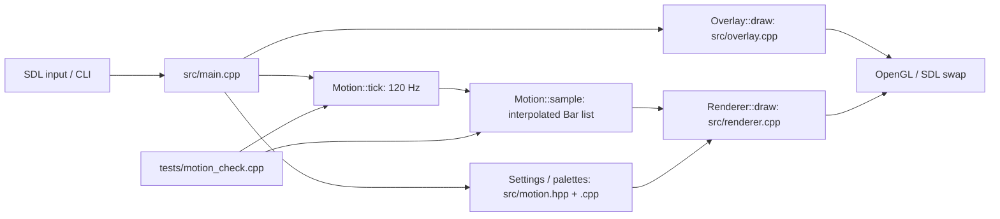

# Undertow code map

Native C++20 screensaver. SDL2 owns the window and input; OpenGL draws the bars.



| Task | Start here |
| --- | --- |
| CLI flags, keyboard controls, fullscreen, exit behavior | `src/main.cpp`: `parse`, `main` |
| 120 Hz simulation, interpolation, frame cap, statistics | `src/main.cpp`: main loop |
| Bar positions, lengths, visible counts, movement | `src/motion.cpp`: `Motion::tick`, `Motion::sample` |
| Defaults, palettes, motion names, data structures | `src/motion.hpp`: `Settings`, `Bar`, `palettes`, `styles` |
| Preferences and migration | `src/motion.cpp`: `Settings::load`, `save`, `clamp` |
| Gradients, rounded corners, antialiasing, GPU buffers | `src/renderer.cpp`: `Renderer` + embedded GLSL |
| BMP frame capture | `src/renderer.cpp`: `Renderer::capture` |
| Options overlay layout and font atlas | `src/overlay.cpp`: `Overlay` |
| Motion invariants and reproducibility | `tests/motion_check.cpp` |
| Build targets and dependencies | `CMakeLists.txt` |
| Usage and installation details | `README.md` |

Build and verify from this directory:

```sh
cmake -S . -B build -DCMAKE_BUILD_TYPE=Release
cmake --build build -j 4
ctest --test-dir build --output-on-failure
./build/undertow --windowed --options
```

Runtime: `~/.local/bin/undertow` links to `build/undertow`. The launcher is
`~/.local/share/applications/undertow.desktop`. Preferences are stored in
`${XDG_CONFIG_HOME:-~/.config}/undertow/settings`.

Contracts: at most three bars per column, variable visible counts, fixed 120 Hz
simulation, 120 FPS render target, release optimization. A 60 Hz panel displays
at most 60 distinct frames each second. Rebuild the binary after source edits.
